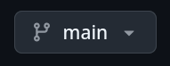

# Programming Workflow Exercise

## Commit message Analysis

1. Look at the previous two commit messages in this repo. briefly explain below which commit message is a good and which is bad, and why.

<your answer here>

2. Commit your answer

3. Notice in the changes window there is now an option called "publish branch". Press that button, then when it finishes open the repository on Github.
    a. Select the branches button.  Your branch should now be listed. 
    b. Select that branch, then open exercise.md in the brower. You should see the answer you added under question 1. 

3. Go back and create a new branch from main. Name this branch practice/<last name>
4. Answer below based on whether you are working in a codespace or on your computer:
    a. Where are you working on this file? _____
    b. Is where you are working on this file a clone of the repo? Why or why not?
5. Commit your answer to question 4.
6. pull your practice/<first name> branch into this branch. (use either pull from in vscode or the command line.)

 ### Note:
    You may get an error that looks something like this: